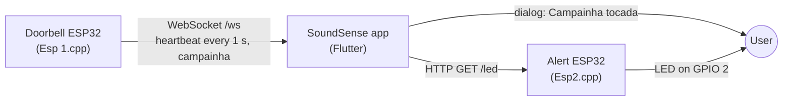

# SoundSense: IoT Interaction System for the Deaf

## Introduction
SoundSense is an innovative IoT solution designed to enable people with hearing impairments to interact with sound-emitting objects in their homes, such as doorbells, alarms, and other essential devices. This system uses a combination of smart technology and user-friendly interfaces to ensure seamless integration into daily life.
 

## How it works



The system has three parts on the same Wi-Fi network. The firmware for both boards lives in [soundsense-esp32](https://github.com/viniciusbregoli/soundsense-esp32).

- **Doorbell board** (`Esp 1.cpp`): runs a WebSocket server at `/ws`, sends `heartbeat` every second and sends `campainha` when GPIO 2 reads high. In the current firmware GPIO 2 is set as an output and driven high at startup, so `campainha` goes out once, right after boot, and not on a button press.
- **App** (this repo): tapping **Campainha** on the home screen connects to the doorbell's WebSocket. The button turns green while messages keep arriving and back to orange after 5 s without one. When `campainha` arrives, the app calls the alert board and shows a "Campainha tocada" dialog.
- **Alert board** (`Esp2.cpp`): runs an HTTP server; `GET /led` turns on the LED on GPIO 2 so the ring is also visible in the room.

The app also has a screen that scans for Bluetooth LE devices and shows a local notification when a subscribed characteristic changes. The temperature and humidity values on the home card and the Wi-Fi device list are placeholders.

## Running the app

The app is a Flutter project (package name `sada`).

```
flutter pub get
flutter run
```

The board addresses are hard-coded in `lib/devices.dart`: point them at the IPs your two ESP32 boards get on your network before running.
