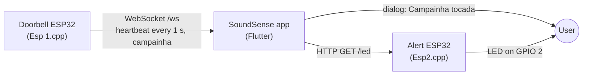

# SoundSense: IoT Interaction System for the Deaf

## Introduction
SoundSense is an innovative IoT solution designed to enable people with hearing impairments to interact with sound-emitting objects in their homes, such as doorbells, alarms, and other essential devices. This system uses a combination of smart technology and user-friendly interfaces to ensure seamless integration into daily life.
 

## How it works

